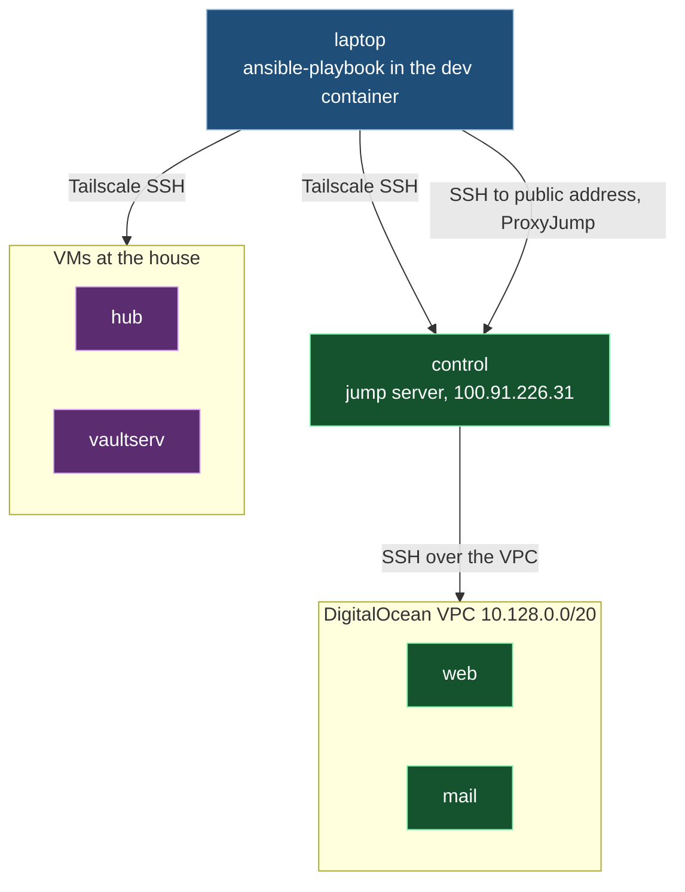
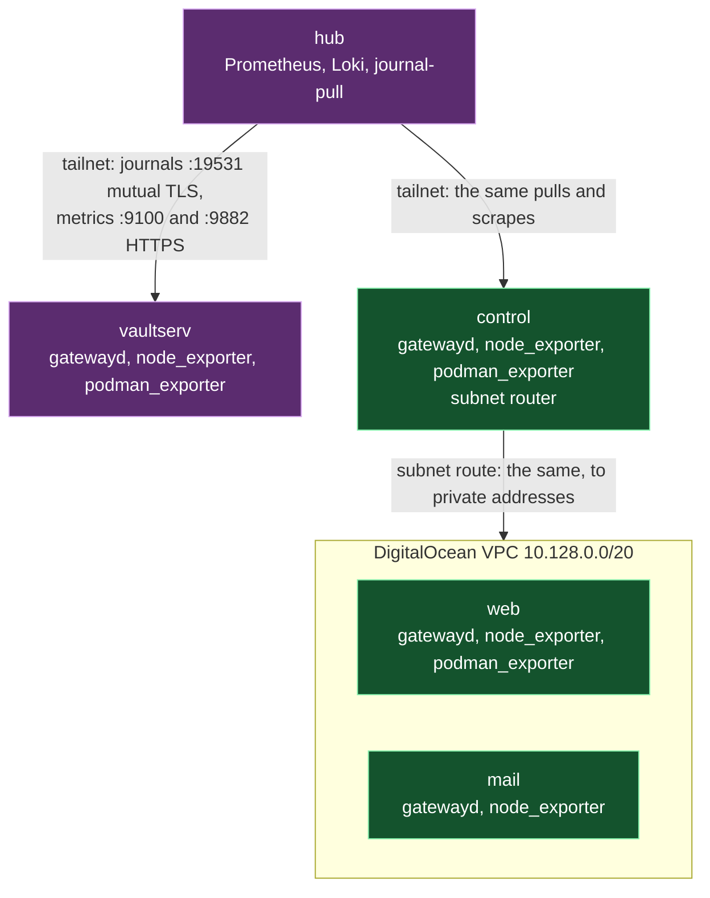

# Architecture

How the pieces of this repository fit together, and which piece owns each shared thing. When a
change doesn't fit this, change this file first, on purpose, in the same commit.

## The shape

This repository describes five machines. `hub` and `vaultserv` are VMs at the house; `web`,
`mail` and `control` are DigitalOcean droplets. Ansible runs from the laptop, inside the `dev`
container, because the repository's vault lookup invokes `bw` at run time and `bw` only works there.
Each playbook does one job by applying one role to the machines that need it, and `site.yml`
runs `baseline` and `access` everywhere.

Ansible reaches the tailnet machines over Tailscale SSH. It reaches `web` and `mail` only through
`control` as a jump server, at `control`'s public address. `control` also advertises the VPC as
a Tailscale subnet route, but that route is not the administrative path.

The `hub` role runs the monitoring stack. Every other machine runs a journal gateway and
`node_exporter`, and those with containers also run `podman_exporter`. The hub pulls each
machine's journal over mutual TLS and scrapes its metrics over HTTPS with basic auth. It reaches
`web` and `mail` at their private addresses through `control`'s subnet route, which the `hub`
role accepts while keeping the hub's own subnet on the main routing table.

## The pieces

| Piece | Owns | Interface and dependencies | How it fails | Must not |
|---|---|---|---|---|
| `ansible/inventory.ini`, `group_vars/`, `host_vars/` | The machines, their groups, the shared `tailnet_domain` and `restic_image`, and what differs per machine, such as each service's `*_listen_address`, the B2 bucket list and OpenBao's account, port, seal key ID and credentials. | Variables every role reads. Secrets use `vault_secret` on the laptop, evaluated only when a task uses them. B2's master key ID and secret are looked up for the controller, while `b2_credentials_user` names the hub account. | The lookup fails when the vault session or item is unavailable. | Hold a secret value, encrypted or not. |
| `roles/become_password` | Fetching each machine's sudo password once per run and storing it as a fact. | Each playbook's password play names its own hosts and runs this role. Calls `vault_secret`, which runs `bw` on the laptop. | Refuses a run reaching more than one machine without `--limit`, before any vault read. Stops with a safe message when the vault session or item is unavailable. | Write the password anywhere but the in-memory fact. |
| `playbooks/<job>.yml` | The order of one job: which role runs on which group, and the checks that must pass first. | Each job playbook has a password play that runs `become_password` on its own hosts; `hub.yml` first opens droplet SSH connections from the hub. `site.yml` imports the fleet `baseline.yml` and `access.yml`; `hub.yml` runs baseline and access on the hub itself before its services, then applies `openbao` after `backup_server`. `vaultserv.yml` applies `vaultwarden_backup` to vaultserv after fetching the become password. `b2.yml` applies `b2_bucket` to `hub`, `b2-copy.yml` applies `b2_copy` to `hub`, and `backup-prune.yml` applies `backup_prune` to `hub`. | A failed host stops that host; Ansible's normal behaviour. | Hold work a role should own. |
| `roles/baseline` | What every machine gets before it gets a job: packages, automatic security updates, swap, fail2ban, firewalld, rootless Podman, journald and core-dump limits. | Run on every machine. Its checker script, `files/repo-gpgcheck-check.py`, runs on the target. | Its verify tasks fail when the live state differs from what it set. | Open a port for a service; the role that runs the service opens its own. |
| `roles/access` | The admin account and its key in a root-owned location, no passwordless sudo for any account but root, and the SSH hardening. | Run on every machine. `files/sudo-nopasswd-check.py` runs on the target. | Verifies the sshd configuration that actually takes effect, and fails if it differs. | Lock out the account Ansible connects as. |
| `roles/journal_gateway` | `systemd-journal-gatewayd` on every machine but the hub: its private key and self-signed certificate, and trusting only the hub's client certificate. | Reads the hub's public client certificate from the hub, and installs its own server certificate on the hub as that machine's trust anchor. `journal-gateway.yml` creates the client certificate first. | Refuses a gatewayd build that can't check client certificates, as AlmaLinux 10's wasn't. | Accept any client but the hub. |
| `roles/node_exporter` | `node_exporter` from a pinned release checked against its SHA-256, served over HTTPS with basic auth, plus the reboot-required metric. | Its certificate is read by the `hub` role into the one file Prometheus trusts. `filter_plugins/node_exporter_firewall.py` plans its firewall rules. | Its verify fails when the service, certificate or firewall rules differ from the role's claim. | Open its port to any source but the scrape addresses. |
| `roles/podman_exporter` | `podman_exporter` as a Quadlet container in the workload account, over HTTPS with basic auth. | The image is pinned. The `hub` role reads its certificate and password. | Removes firewall rules it no longer owns, and verifies the rest. | Open its port to anything but the hub. |
| `roles/hub` | The monitoring stack as rootless Quadlet containers: Prometheus, Alertmanager, Grafana, Loki, Alloy, ntfy and Gatus. Also the journal pulls, the hub's routes to the VPC, the journal client certificate, and the backup disk's XFS filesystem and mount. Its `tailscale-service.yml` stays for ntfy and Grafana until the hub split. | Reads every machine's listen addresses and exporter passwords through `hostvars`, and their exporter certificates over SSH. Alert rules and their tests are in `files/`. The backup disk's stable path comes from hub host variables. | Each service and the backup disk have setup and verify task files; verify fails on any difference. | Change another machine's configuration; it only reads from them. |
| `roles/backup_server` | A separate rootless rclone REST server account, its mounted data folder, htpasswd file, Quadlet and refusal checks. | Reads the mount path and verify credentials from hub host variables. Uses the pinned rclone and restic images. | Its pre-start mount check retries until the disk returns; verify tasks fail if a backup cannot be written or a deletion, cross-login access or anonymous request is allowed. | Hold any server-side power to delete repository data, or change Tailscale. |
| `roles/openbao` | OpenBao's separate rootless account, pinned container, Raft storage, static seal, audit file and first-start configuration. | Reads the hub's account, port, key ID and three credentials from inventory. The container publishes only to loopback; the role verifies initialized and unsealed health, the key file, the removed first-start file and an audited ansible login. | A missing key, failed initialization, sealed service or missing loopback audit record fails verification. | Hold or print a root token; keep the first-start file after initialization; sign in as keepbreath0 on a routine run. |
| `roles/vaultwarden_backup` | The local Vaultwarden database copy, restic backup job, system timer, and restore proof. | Requires the workload account, data and Quadlet paths, container name, repository, login and two secrets from inventory. Uses the shared pinned `restic_image`. Baseline must enable lingering for the account before this role runs; the role fails before writing files if it is absent. The account's user manager runs Podman; a system service starts it and waits so a failure reaches system monitoring. | A failed copy or restic run fails the system service. `vaultwarden_backup_timeout` bounds the run unit, with five more minutes for the system service. Verification compares live database counts and files to the newest restored snapshot and starts a throwaway Vaultwarden from the live Quadlet image. | Delete or forget repository data; write into the data folder except its own database copy; stop, restart or reconfigure Vaultwarden; hold hub storage or Backblaze credentials. |
| `roles/b2_bucket` | Each machine's B2 bucket, its object lock and lifecycle settings, its hub key, and the private credential file. | Master-key API calls run on the laptop. The hub stores `/home/<b2_credentials_user>/.config/b2/<machine>.env` with `AWS_ACCESS_KEY_ID`, `AWS_SECRET_ACCESS_KEY` and `RESTIC_REPOSITORY`; B4b reads that file. The hub-side verifier reads the key locally and checks that deletion of a file version is refused before restoring a hidden file. | Rejects legacy key entries without `bucketIds`, API errors, settings drift and a key that can delete a version. A second run makes no changes. | Send the master key to any machine; give a hub key `deleteFiles`, `writeBuckets`, `writeBucketLifecycleRules`, `writeBucketRetentions`, `writeFileRetentions` or `bypassGovernance`; delete a bucket or a file version. |
| `roles/b2_copy` | One B2 repository and nightly copy per machine in `b2_buckets`. | Reads B4a's credential files and the backup server's repository root. The hub account holds each pair of repository passwords. System timers start the account's restic copy units, and verify tasks compare snapshots, read all copied data and inspect hidden locks. | Fails when a password or credential is missing, a copy fails, the snapshots differ, or B2 has deleted a lock version. | Hold the master key; forget, prune or delete repository data; delete a file version; relabel the repository root. |
| `roles/backup_prune` | Weekly forget, prune and full read of each machine's hub and B2 repositories. | Reads `b2_copy`'s password files, B4a's credential file and the backup server's repository root. System timers start the account's prune and check units; verify tasks run a read-only forget dry run. | Refuses a missing input file before changes; a failed step fails its unit. | Prune or check through the append-only server; forget on B2 by following the hub snapshot list; prune or check from a play run; write a password or credential file; hold the master key. |
| `roles/break_glass_sheet` | Rotating the read-only B2 sheet key and printing one recovery sheet. | Reads the bucket list, B2 master key, repository passwords and pinned images from inventory. Master-key API calls run on the laptop; the hub restores with the new key, and the laptop then asks B2's native API, with the new key, for an upload URL and requires a refusal before older sheet keys are retired. | Refuses a missing password or bucket before creating a key. If a proof fails, it deletes the new key and keeps the older keys. | Send the master key to the hub; print a sheet before the restore and write-refusal proofs pass; delete an older key before proof. |
| `roles/tailscale_service` | One machine's serve mapping for one named Tailscale Service. | Takes the Service name and loopback HTTP port and reads `tailnet_domain`; HTTPS on 443 faces the tailnet. | Reads live serve status, and clears and replaces this Service's mapping only when it differs. | Serve, clear or change any Service other than the one it is given. |
| `roles/hub/files/journal-pull.py` | Pulling one machine's journal over mutual TLS and importing it with its cursors intact, so a restart resumes where it stopped. | Run by `journal-pull@.service`, one instance per machine. `journal-resume-test.py` is the live check for resuming. | Records gaps as a metric the hub alerts on. | Skip or reorder entries silently. |
| `ansible/filter_plugins/` | Pure functions Ansible calls: `durations.py` turns Prometheus and Loki duration strings into seconds; `node_exporter_firewall.py` plans firewall rules; `b2_bucket.py` plans bucket creation and exact settings updates. | Imported by Ansible from `ansible/`; Python tests and mutation exercise their public results. | Raise on input they can't parse. | Touch a machine. |
| `ansible/lookup_plugins/` | `vault_secret` selects the controller's vault session and returns one password, username or named custom field. | Found through `ansible.cfg`; each call runs one `bw get item` on the laptop with the key only in that child process's environment. | Raises a fixed `AnsibleLookupError` naming the requested item, optional field, session source and `vu` remedy. | Cache secrets, return whole items, pass the key as an argument or Ansible variable, or expose CLI output. |
| `ansible/tests/` | Python tests for the filter plugins and scripts in role `files/` folders, including one loader for mutmut path-based module names. `hub_backup_disk/`, `backup_server/`, `b2_bucket/`, `vaultwarden_backup/`, `b2_copy/`, `backup_prune/`, and `break_glass_sheet/` have bash drivers and test playbooks. | Run Python tests with `python3 -m pytest ansible/tests` from the repository root. CI runs the bash drivers as root against local loop devices and containers; the B2 copy, backup prune and break-glass drivers use local SeaweedFS containers. | An assertion fails when live runner behaviour differs. | Reach a real machine, tailnet or vault. |
| `pyproject.toml` | The Python source folders used by coverage and mutation, plus the test path. | Read by pytest, mutmut, and the shared Python CI workflow. | A missing source folder leaves its code outside those checks. | Depend on a virtual environment or home-directory path. |
| `tailscale/policy.hujson` | The record of the tailnet policy. | Pasted into the admin console by hand; the console is the live copy. | Nothing checks that the two match yet. | Differ from the console after a change. |
| `workstation/vm-autostart/` | Starting the workstation's VirtualBox VMs when Windows starts and stopping them cleanly when it shuts down. | A PowerShell module, scripts and a small Windows service, installed by `install.ps1`, with Pester tests in `tests/`. | | Depend on anything in `ansible/`. |
| `.github/workflows/ci.yml` | CI: `ansible-lint`, syntax checks, Python tests with branch coverage, `hub-backup-disk` loop-device tests, `backup-server` and `openbao` role tests, `b2-bucket` role tests, and the `vaultwarden-backup`, `b2-copy`, `backup-prune` and `break-glass-sheet` jobs, on every branch push. | The `main` ruleset requires the lint and syntax jobs by name. The device, B2, OpenBao and Vaultwarden jobs use loop devices and local containers on the GitHub runner and reach no estate machine. The OpenBao, Vaultwarden, B2 copy, backup prune and break-glass drivers use `ansible/tests/lib/undo.sh` for registered cleanup. | The job fails on a role, backup, restore or refusal-check regression. | Need a secret: a syntax check never evaluates the vault lookups. |

## Rules every piece follows

- **No secrets in the repository.** Not encrypted, not in an example, not in a reverted commit.
  They are read at run time. Today `vault_secret` uses `bw`; machine secrets move to OpenBao on
  the hub once it exists, and the vault lookups in the inventory are what it replaces.
- **Every role proves what it claims.** Its setup tasks are followed by verify tasks that read
  the live state, and a second run of the same playbook must report `changed=0`.
- **Rehearse before a live run.** Run with `--check --diff` against one `--limit` host first.
- **Pin what is downloaded.** Releases are checked against a SHA-256 and images are pinned.
- **Each role opens only its own ports,** and only to the sources that need them.
- **`web` and `mail` are reached only through `control`.** The subnet route on the laptop is not
  the administrative path.
- **Roles share data in two ways only:** inventory variables read through `hostvars`, and the
  certificate exchanges named in the table above.
