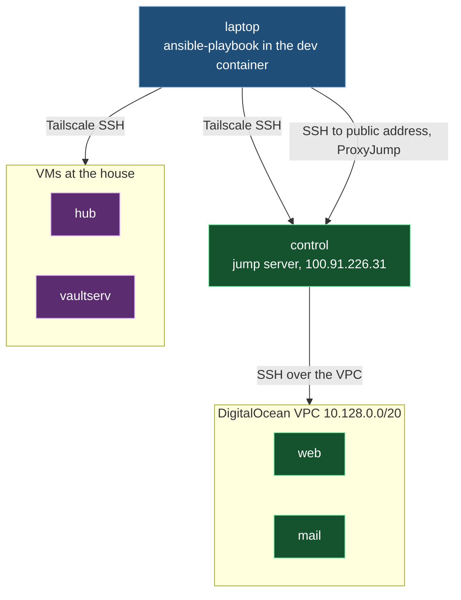
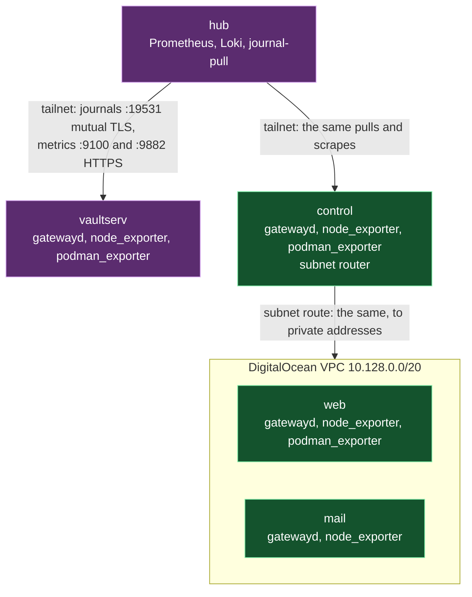

# Architecture

How the pieces of this repository fit together, and which piece owns each shared thing. When a
change doesn't fit this, change this file first, on purpose, in the same commit.

## The shape

This repository describes five machines. `hub` and `vaultserv` are VMs at the house; `web`,
`mail` and `control` are DigitalOcean droplets. Ansible runs from the laptop, inside the `dev`
container, because every secret is a `bw` lookup evaluated at run time and `bw` only works there.
Each playbook does one job by applying one role to the machines that need it, and `site.yml`
runs `baseline` and `access` everywhere.

Ansible reaches the tailnet machines over Tailscale SSH. It reaches `web` and `mail` only through
`control` as a jump server, at `control`'s public address. `control` also advertises the VPC as
a Tailscale subnet route, but that route is not the administrative path.

The `hub` role runs the monitoring stack. Every other machine runs a journal gateway and
`node_exporter`, and those with containers also run `podman_exporter`. The hub pulls each
machine's journal over mutual TLS and scrapes its metrics over HTTPS with basic auth. It reaches
`web` and `mail` at their private addresses through `control`'s subnet route, which the `hub`
role accepts while keeping the hub's own subnet on the main routing table.

## The pieces

| Piece | Owns | Interface and dependencies | How it fails | Must not |
|---|---|---|---|---|
| `ansible/inventory.ini`, `group_vars/`, `host_vars/` | The machines, their groups, and what differs per machine, such as each service's `*_listen_address`. | Variables every role reads. Secrets are `bw` lookups, evaluated only when a task uses them. | A lookup fails when the vault is locked or `bw` isn't on the path. | Hold a secret value, encrypted or not. |
| `playbooks/become-password.yml` | Fetching each machine's sudo password once per run and storing it as a fact. | Imported first by every playbook. Runs `bw` on the laptop. | Stops the run with a message when the vault is locked. | Write the password anywhere but the in-memory fact. |
| `playbooks/<job>.yml` | The order of one job: which role runs on which group, and the checks that must pass first. | One role per playbook, except `site.yml` and `hub.yml`, which run the shared roles before their own. | A failed host stops that host; Ansible's normal behaviour. | Hold work a role should own. |
| `roles/baseline` | What every machine gets before it gets a job: packages, automatic security updates, swap, fail2ban, firewalld, rootless Podman, journald and core-dump limits. | Run on every machine. Its checker script, `files/repo-gpgcheck-check.py`, runs on the target. | Its verify tasks fail when the live state differs from what it set. | Open a port for a service; the role that runs the service opens its own. |
| `roles/access` | The admin account and its key in a root-owned location, no passwordless sudo for any account but root, and the SSH hardening. | Run on every machine. `files/sudo-nopasswd-check.py` runs on the target. | Verifies the sshd configuration that actually takes effect, and fails if it differs. | Lock out the account Ansible connects as. |
| `roles/journal_gateway` | `systemd-journal-gatewayd` on every machine but the hub: its private key and self-signed certificate, and trusting only the hub's client certificate. | Reads the hub's public client certificate from the hub, and installs its own server certificate on the hub as that machine's trust anchor. `journal-gateway.yml` creates the client certificate first. | Refuses a gatewayd build that can't check client certificates, as AlmaLinux 10's wasn't. | Accept any client but the hub. |
| `roles/node_exporter` | `node_exporter` from a pinned release checked against its SHA-256, served over HTTPS with basic auth, plus the reboot-required metric. | Its certificate is read by the `hub` role into the one file Prometheus trusts. `filter_plugins/node_exporter_firewall.py` plans its firewall rules. | Its verify fails when the service, certificate or firewall rules differ from the role's claim. | Open its port to any source but the scrape addresses. |
| `roles/podman_exporter` | `podman_exporter` as a Quadlet container in the workload account, over HTTPS with basic auth. | The image is pinned. The `hub` role reads its certificate and password. | Removes firewall rules it no longer owns, and verifies the rest. | Open its port to anything but the hub. |
| `roles/hub` | The monitoring stack as rootless Quadlet containers: Prometheus, Alertmanager, Grafana, Loki, Alloy, ntfy and Gatus. Also the journal pulls, the hub's routes to the VPC, the journal client certificate, and the backup disk's XFS filesystem and mount. | Reads every machine's listen addresses and exporter passwords through `hostvars`, and their exporter certificates over SSH. Alert rules and their tests are in `files/`. The backup disk's stable path comes from hub host variables. | Each service and the backup disk have setup and verify task files; verify fails on any difference. | Change another machine's configuration; it only reads from them. |
| `roles/hub/files/journal-pull.py` | Pulling one machine's journal over mutual TLS and importing it with its cursors intact, so a restart resumes where it stopped. | Run by `journal-pull@.service`, one instance per machine. `journal-resume-test.py` is the live check for resuming. | Records gaps as a metric the hub alerts on. | Skip or reorder entries silently. |
| `ansible/filter_plugins/` | Pure functions Ansible calls: `durations.py` turns Prometheus and Loki duration strings into seconds; `node_exporter_firewall.py` works out which firewall rules are present and which are stale. | Imported by Ansible from `ansible/`. | Raise on input they can't parse. | Touch a machine. |
| `ansible/tests/` | Python tests for the filter plugins and the scripts in role `files/` folders, including one loader that gives source files their mutmut path-based module names. | Run with `python3 -m pytest ansible/tests` from the repository root. | | Reach a real machine. |
| `pyproject.toml` | The four Python source folders used by coverage and mutation, plus the test path. | Read by pytest, mutmut, and the shared Python CI workflow. | A missing source folder leaves its code outside those checks. | Depend on a virtual environment or home-directory path. |
| `tailscale/policy.hujson` | The record of the tailnet policy. | Pasted into the admin console by hand; the console is the live copy. | Nothing checks that the two match yet. | Differ from the console after a change. |
| `workstation/vm-autostart/` | Starting the workstation's VirtualBox VMs when Windows starts and stopping them cleanly when it shuts down. | A PowerShell module, scripts and a small Windows service, installed by `install.ps1`, with Pester tests in `tests/`. | | Depend on anything in `ansible/`. |
| `.github/workflows/ci.yml` | CI: `ansible-lint`, a syntax check of every playbook, Python tests with branch coverage, and `hub-backup-disk` loop-device tests, on pull requests and every branch push. | The `main` ruleset requires the lint and syntax jobs by name, so renaming either means changing the ruleset in the same change. The disk job uses loop devices on the GitHub runner and reaches no estate machine. | | Need a secret: a syntax check never evaluates the `bw` lookups. |

## Rules every piece follows

- **No secrets in the repository.** Not encrypted, not in an example, not in a reverted commit.
  They are read at run time. Today that is a `bw` lookup; machine secrets move to OpenBao on the
  hub once it exists, and the `bw` lookups in the inventory are what it replaces.
- **Every role proves what it claims.** Its setup tasks are followed by verify tasks that read
  the live state, and a second run of the same playbook must report `changed=0`.
- **Rehearse before a live run.** Run with `--check --diff` against one `--limit` host first.
- **Pin what is downloaded.** Releases are checked against a SHA-256 and images are pinned.
- **Each role opens only its own ports,** and only to the sources that need them.
- **`web` and `mail` are reached only through `control`.** The subnet route on the laptop is not
  the administrative path.
- **Roles share data in two ways only:** inventory variables read through `hostvars`, and the
  certificate exchanges named in the table above.
