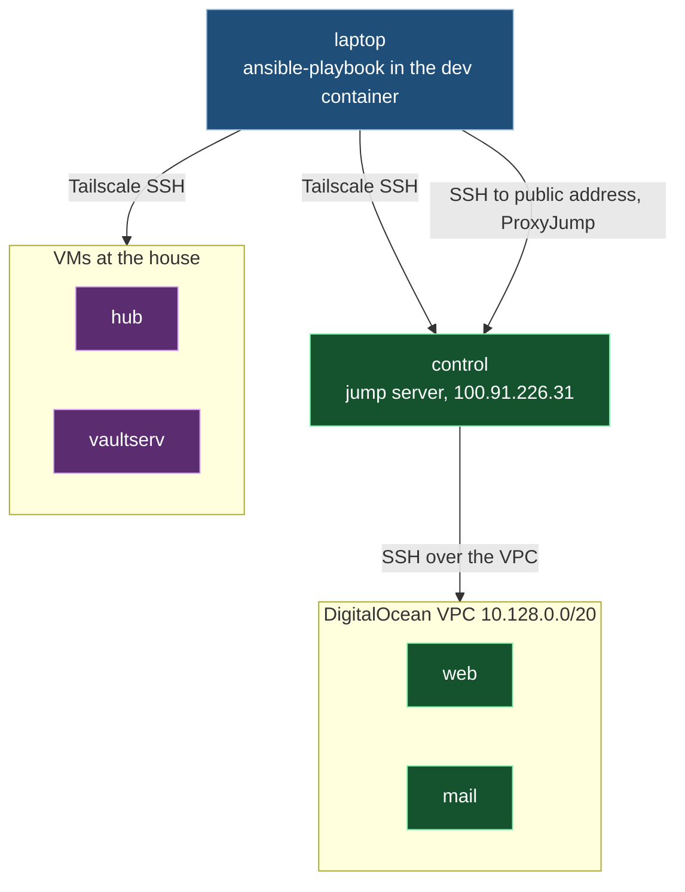
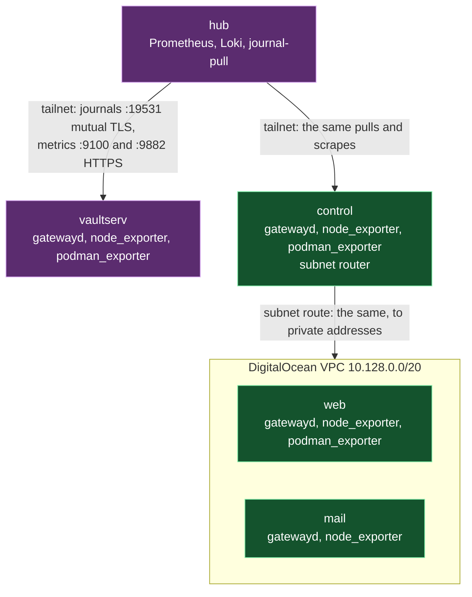

# Architecture

How the pieces of this repository fit together, and which piece owns each shared thing. When a
change doesn't fit this, change this file first, on purpose, in the same commit.

## The shape

This repository describes five machines. `hub` and `vaultserv` are VMs at the house; `web`,
`mail` and `control` are DigitalOcean droplets. Ansible runs from the laptop, inside the `dev`
container, because the repository's vault lookup invokes `bw` at run time and `bw` only works there.
Each playbook does one job by applying one role to the machines that need it, and `site.yml`
runs `baseline` and `access` everywhere.

Ansible reaches the tailnet machines over Tailscale SSH. It reaches `web` and `mail` only through
`control` as a jump server, at `control`'s public address. `control` also advertises the VPC as
a Tailscale subnet route, but that route is not the administrative path.

The `hub` role runs the monitoring stack. Every other machine runs a journal gateway and
`node_exporter`, and those with containers also run `podman_exporter`. The hub pulls each
machine's journal over mutual TLS and scrapes its metrics over HTTPS with basic auth. It reaches
`web` and `mail` at their private addresses through `control`'s subnet route, which the `hub`
role accepts while keeping the hub's own subnet on the main routing table.

## The pieces

| Piece | Owns | Interface and dependencies | How it fails | Must not |
|---|---|---|---|---|
| `ansible/inventory.ini`, `group_vars/`, `host_vars/` | The machines, their groups, the shared `tailnet_domain` and `restic_image`, and what differs per machine, such as each service's `*_listen_address`, the B2 bucket list, OpenBao's account, port, self address, seal key ID, credentials, consumer list and bound addresses. | Variables every role reads. `openbao_self_address` is the address the role forwards on its own loopback requests; `openbao_approles` names consumers and their accounts, and `openbao_approle_bound_cidrs` binds their sign-ins and tokens. Secrets use `vault_secret` on the laptop, evaluated only when a task uses them. B2's master key ID and secret are looked up for the controller, while `b2_credentials_user` names the hub account. | The lookup fails when the vault session or item is unavailable. | Hold a secret value, encrypted or not. |
| `roles/become_password` | Fetching each machine's sudo password once per run and storing it as a fact. | Each playbook's password play names its own hosts and runs this role. Calls `vault_secret`, which runs `bw` on the laptop. | Refuses a run reaching more than one machine without `--limit`, before any vault read. Stops with a safe message when the vault session or item is unavailable. | Write the password anywhere but the in-memory fact. |
| `playbooks/<job>.yml` | The order of one job: which role runs on which group, and the checks that must pass first. | Each job playbook has a password play that runs `become_password` on its own hosts; `hub.yml` first opens droplet SSH connections from the hub. `site.yml` imports the fleet `baseline.yml` and `access.yml`; `hub.yml` runs baseline and access on the hub itself before its services, then applies `openbao` after `backup_server`, and `openbao_client` directly after `openbao_config`. `vaultserv.yml` applies `vaultwarden_backup` to vaultserv after fetching the become password. `b2.yml` applies `b2_bucket` to `hub`, `b2-copy.yml` applies `b2_copy` to `hub`, `backup-prune.yml` applies `backup_prune` to `hub`, and `hub-pull.yml` makes the hub's pull key, applies `hub_export` to `hub_exports`, the inventory group holding `webservers` and `mailservers`, reads each one's own host key, then applies `hub_pull` to `hub`. A test keeps `hub_exports` equal to the hosts in the hub's `hub_pull_machines`. | A failed host stops that host; Ansible's normal behaviour. | Hold work a role should own. |
| `roles/baseline` | What every machine gets before it gets a job: packages, among them `acl` for Ansible's `setfacl` when it works as another account, automatic security updates, swap, fail2ban, firewalld, rootless Podman, journald and core-dump limits. | Run on every machine. Its checker script, `files/repo-gpgcheck-check.py`, runs on the target. | Its verify tasks fail when the live state differs from what it set. | Open a port for a service; the role that runs the service opens its own. |
| `roles/access` | The admin account and its key in a root-owned location, no passwordless sudo for any account but root, and the SSH hardening. | Run on every machine. `files/sudo-nopasswd-check.py` runs on the target. | Verifies the sshd configuration that actually takes effect, and fails if it differs. | Lock out the account Ansible connects as. |
| `roles/journal_gateway` | `systemd-journal-gatewayd` on every machine but the hub: its private key and self-signed certificate, and trusting only the hub's client certificate. | Reads the hub's public client certificate from the hub, and installs its own server certificate on the hub as that machine's trust anchor. `journal-gateway.yml` creates the client certificate first. | Refuses a gatewayd build that can't check client certificates, as AlmaLinux 10's wasn't. | Accept any client but the hub. |
| `roles/node_exporter` | `node_exporter` from a pinned release checked against its SHA-256, served over HTTPS with basic auth, plus the reboot-required metric. | Its certificate is read by the `hub` role into the one file Prometheus trusts. `filter_plugins/node_exporter_firewall.py` plans its firewall rules. | Its verify fails when the service, certificate or firewall rules differ from the role's claim. | Open its port to any source but the scrape addresses. |
| `roles/podman_exporter` | `podman_exporter` as a Quadlet container in the workload account, over HTTPS with basic auth. | The image is pinned. The `hub` role reads its certificate and password. | Removes firewall rules it no longer owns, and verifies the rest. | Open its port to anything but the hub. |
| `roles/hub` | The monitoring stack as rootless Quadlet containers: Prometheus, Alertmanager, Grafana, Loki, Alloy, ntfy and Gatus. Also the journal pulls, the hub's routes to the VPC, the journal client certificate, and the backup disk's XFS filesystem and mount. Its `tailscale-service.yml` stays for ntfy and Grafana until the hub split. | Reads every machine's listen addresses and exporter passwords through `hostvars`, and their exporter certificates over SSH. Alert rules and their tests are in `files/`. Gatus's OpenBao check reads `/v1/sys/health` through `svc:openbao` and has no Gatus alert; its `OpenBaoUnhealthy` rule carries `band_health="true"`, which Alertmanager's first route sends straight to ntfy's tickets topic, grouped per alert and never paging. The backup disk's stable path comes from hub host variables. | Each service and the backup disk have setup and verify task files; verify fails on any difference. Gatus's verify requires the OpenBao check to be loaded but not passing, because `hub.yml` applies `openbao` after this role and that role's verify proves OpenBao healthy. | Change another machine's configuration; it only reads from them. |
| `roles/backup_server` | A separate rootless rclone REST server account, its mounted data folder, htpasswd file, Quadlet and refusal checks. | Reads the mount path and verify credentials from hub host variables. Uses the pinned rclone and restic images. | Its pre-start mount check retries until the disk returns; verify tasks fail if a backup cannot be written or a deletion, cross-login access or anonymous request is allowed. | Hold any server-side power to delete repository data, or change Tailscale. |
| `roles/openbao` | OpenBao's separate rootless account, pinned container, Raft storage, static seal, audit output to the container's standard output and the journal, and first-start configuration. | Reads the hub's account, port, self address, key ID and three credentials from inventory. The container publishes only to loopback; the listener trusts X-Forwarded-For only from loopback and refuses requests without it. Its first-start ansible policy grants a metadata read on `secret/metadata/restore-check/*`. The role verifies initialized and unsealed health, the key file, the removed first-start file and an audited ansible login with the forwarded self address. | A missing key, failed initialization, sealed service or missing forwarded audit record fails verification. | Hold or print a root token; keep the first-start file after initialization; sign in as keepbreath0 on a routine run. |
| `roles/vaultwarden_backup` | The local Vaultwarden database copy, restic backup job, system timer, and restore proof. | Requires the workload account, data and Quadlet paths, container name, repository, login and two secrets from inventory. Uses the shared pinned `restic_image`. Baseline must enable lingering for the account before this role runs; the role fails before writing files if it is absent. The account's user manager runs Podman; a system service starts it and waits so a failure reaches system monitoring. | A failed copy or restic run fails the system service. `vaultwarden_backup_timeout` bounds the run unit, with five more minutes for the system service. Verification compares live database counts and files to the newest restored snapshot and starts a throwaway Vaultwarden from the live Quadlet image. | Delete or forget repository data; write into the data folder except its own database copy; stop, restart or reconfigure Vaultwarden; hold hub storage or Backblaze credentials. |
| `roles/b2_bucket` | Each machine's B2 bucket, its object lock and lifecycle settings, its hub key, and the private credential file. | Master-key API calls run on the laptop. The hub stores `/home/<b2_credentials_user>/.config/b2/<machine>.env` with `AWS_ACCESS_KEY_ID`, `AWS_SECRET_ACCESS_KEY` and `RESTIC_REPOSITORY`; B4b reads that file. The hub-side verifier reads the key locally and checks that deletion of a file version is refused before restoring a hidden file. | Rejects legacy key entries without `bucketIds`, API errors, settings drift and a key that can delete a version. A second run makes no changes. | Send the master key to any machine; give a hub key `deleteFiles`, `writeBuckets`, `writeBucketLifecycleRules`, `writeBucketRetentions`, `writeFileRetentions` or `bypassGovernance`; delete a bucket or a file version. |
| `roles/b2_copy` | One B2 repository and nightly copy per machine in `b2_buckets`. | Reads B4a's credential files and the backup server's repository root. The hub account holds each pair of repository passwords. System timers start the account's restic copy units, and verify tasks compare snapshots, read all copied data and inspect hidden locks. | Fails when a password or credential is missing, a copy fails, the snapshots differ, or B2 has deleted a lock version. | Hold the master key; forget, prune or delete repository data; delete a file version; relabel the repository root. |
| `roles/backup_prune` | Weekly forget, prune and full read of each machine's hub and B2 repositories. | Reads `b2_copy`'s password files, B4a's credential file and the backup server's repository root. System timers start the account's prune and check units; verify tasks run a read-only forget dry run. | Refuses a missing input file before changes; a failed step fails its unit. | Prune or check through the append-only server; forget on B2 by following the hub snapshot list; prune or check from a play run; write a password or credential file; hold the master key. |
| `roles/ticket_band` | The ticket band's separate rootless account, Podman transient store and boot cleanup user service. | Reads `ticket_band_user` from the hub host variables. The enabled cleanup runs `podman system prune --external` at boot with a 300-second start limit. | Verification fails if the account does not run Podman with the transient store or the cleanup unit is not enabled. | Create a pod or container, or hold a credential; later items supply those. |
| `roles/hub_pull` | The hub's nightly pull of each droplet's export into that machine's hub repository. | Makes an ed25519 key in the backup server account's home (`tasks_from: key`, run before any droplet changes), pins each droplet's host key from the fact `hub_export_host_key` the playbook reads off the droplet, and installs `hub-pull@.timer`, `hub-pull@.service` and the user unit `hub-pull-run@.service`, which runs `restic backup --stdin-from-command` over SSH through the backup server with the machine's own login. Verify tasks initialize the repository once, start one pull and require its snapshot. | A failed export or SSH refusal fails the run unit with no snapshot. | Let the hub's key leave the hub, trust a host key on first use, restart or retry a pull, or write to a repository except through the backup server. |
| `roles/hub_export` | A droplet's forced-command account, `hubexport`, that the hub pulls one export through. | Makes `hubexport` as a system account with one root-owned `/etc/ssh/authorized_keys/hubexport` entry, `from=` the hub's source address with `restrict` and `command="sudo -n /usr/local/libexec/hub-export"`. Its sshd drop-in makes that key path work before and after the access role runs. It also installs a `visudo`-checked sudo rule for that script with no arguments, and the script. For the `redis` kind the script streams `redis-cli --rdb -` from the container account's Redis; for the `tar` kind it streams an uncompressed tar of `hub_export_tar_paths`, relative to `/`. | Refuses before changes when a kind's own settings are missing: `hub_export_tar_paths` for `tar`, or for `redis` the container settings, or a container account that is missing or not lingering. A missing tar path fails the export, and with it the pull. | Grant `hubexport` any command but the script, accept the key from any other address, or touch the container account or its containers. |
| `roles/openbao_config` | What's inside OpenBao, managed through its API as the `ansible` login: the version 2 key/value store at `secret/`, AppRole sign-in at `approle/`, and each consumer's policy and AppRole. Consumers with files also get a role ID file and secret ID file. The role keeps `restore-check`'s test secret while that entry is listed. `openbao_approles` is the whole truth: on every run the role deletes each AppRole and each policy not on the list, and removes each folder under an account's `.config/openbao/approle/` that belongs to no entry with files. It removes a folder only when its path is exactly `/home/<account>/.config/openbao/approle/<name>`, with an account name and a consumer name of the allowed shapes, and nothing from `.config` down to the folder is a symbolic link; it skips any other folder with a warning that names it. Every task that creates, writes, reads a file in, or removes anything under `/home/<account>/` runs as that account, so a link the account plants or swaps in can only lead it where that account could already reach (OpenBao on the hub decision 61); its `find` and its `stat` checks with `follow: false` are the only things it does there as root. It never deletes the policies `ansible`, `keepbreath0`, `default` and `root`, and never anything under `secret/`. | Reads `openbao_port`, `openbao_self_address`, `openbao_ansible_password`, `openbao_approles` and `openbao_approle_bound_cidrs` from the hub host variables, and runs after `roles/openbao`. An entry may have no files and may add ordered extra paths to its own policy. Every request carries the hub's address in `X-Forwarded-For`. It reads before writing and reports planned changes in check mode. It reissues a secret ID only when its file is absent, empty or rejected with `invalid role or secret ID`, and destroys every other secret ID of that consumer. It reads the test secret's metadata and writes with check-and-set only when its current version is absent, deleted or destroyed. | Fails if OpenBao doesn't answer `sys/health` with 200 outside check mode, if a mount has the wrong type or version, or if a consumer's policy, AppRole, files or sign-in fail verification. | Rewrite or disable an existing mount, read a secret value, keep a token after it ends, touch a secret ID of an entry without files, overwrite a test secret version someone else wrote, give a consumer any policy but its own, set a secret ID's own `cidr_list`, delete the policies `ansible`, `keepbreath0`, `default` or `root`, delete anything under `secret/`, or create, write, read a file in, or remove anything inside a consumer's home as root. |
| `roles/openbao_client` | Putting OpenBao's sign-in helper, Podman's secret driver program and OpenBao's address on the machine: `/usr/local/bin/openbao-read` and `/usr/local/bin/openbao-podman-secret`, each root's and mode 0755, and `/etc/openbao/client.json`, root's and mode 0644, holding `openbao_client_address`, which defaults to `https://openbao.<tailnet_domain>`. Through its `podman-account` entry point, an account's `~/.config/containers/containers.conf.d/openbao.conf`, the account's and mode 0600 in a folder of mode 0700, which makes `openbao-podman-secret` the account's default Podman secret driver with its four commands. Through its `podman-secret` entry point, one Podman secret of an account holding an OpenBao path, and the fact `openbao_client_secret_changed`. | Runs after `roles/openbao_config` in `hub.yml`. `openbao-read <consumer>/<name>` takes the calling account's uid, translating uid 0 through `/proc/self/uid_map` when Podman's rootless user namespace makes the account appear as root, refuses root, and takes that account's home from the password database, never `$HOME`. It reads that consumer's `role-id` and `secret-id` from `.config/openbao/approle/<consumer>/`, signs in through `svc:openbao` so Tailscale's proxy adds the hub's address, reads `secret/data/<consumer>/<name>`, prints its `value` field with no newline, and revokes its token whether or not the read worked. `openbao-podman-secret` is Podman's shell secret driver, called with `store`, `lookup`, `delete` or `list` and the secret's `SECRET_ID`. It keeps each secret's OpenBao path, never its value, in `.config/openbao/podman-secrets/<SECRET_ID>`, mode 0600 in a folder of mode 0700, under the calling account's home, which it finds the way `openbao-read` does, translating uid 0 through `/proc/self/uid_map` and refusing root. `store` accepts only a path `<consumer>/<name>` and an ID of 25 lowercase hex characters, `lookup` replaces itself with `openbao-read` on the stored path, `delete` succeeds when the file is already gone, and `list` prints the stored IDs. Both programs use Python 3's standard library only, under `/usr/bin/python3`. The role's verify task file checks the owners and modes of `openbao-read`, `openbao-podman-secret` and `client.json`, and that `client.json` parses with an address. The account's own role includes `tasks_from: podman-account` with `openbao_client_podman_account` after it writes the account's transient storage, and `tasks_from: podman-secret` with that account, `openbao_client_secret_name` and `openbao_client_secret_path` for each secret its containers use, because only that role knows when its account is ready (OpenBao on the hub decision 72). Both read the account from the password database and run every task in its home as the account, with `XDG_RUNTIME_DIR=/run/user/<uid>` for every podman command. `podman-account` runs `podman info` as the account and requires Podman's transient store with its run root under `/run/user/<uid>/` before it writes the drop-in. `podman-secret` asks `podman secret exists`, reads plain `podman secret inspect` for the driver and its commands and the mapping file under `.config/openbao/podman-secrets/` for the path, then creates the secret when it is absent, removes and creates it when its driver or commands differ, and runs `podman secret create --replace` when its mapping file is missing or holds another path, sending the path on standard input with no newline; it sets `openbao_client_secret_changed` so the including role restarts its unit. Neither reads a secret's value: neither runs `podman secret inspect --showsecret` nor uses `containers.podman.podman_secret`. In check mode both read as usual and report their writes, and for an account that doesn't exist yet, or has no `storage.conf` yet for `podman-account`, they report what they would make. | Every helper failure exits 1 with one line on standard error naming the step and OpenBao's status and first error; a uid map that can't be read or has no line for uid 0 fails with `openbao-read: could not read this namespace's uid map`, and an account that is still uid 0 with `openbao-read: will not run as root`; a failed revoke is reported without changing the exit status. Every `openbao-podman-secret` failure exits 1 with one line on standard error and nothing on standard output, among them `openbao-podman-secret: could not read this namespace's uid map` and `openbao-podman-secret: will not run as root`. Verify fails on a missing file, wrong owner or mode, or an address file without an address. `podman-account` and `podman-secret` fail outside check mode with `openbao_client_podman_account <account> must exist` for a missing account; `podman-account` refuses an account without the transient store or with its run root elsewhere, writing nothing, with `<account> must use Podman's transient store, with its run root under /run/user/<uid>/, before it takes secrets from OpenBao`; `podman-secret` refuses a wrong name or path before it runs podman, and stops on any `podman secret exists` exit but 0 or 1. | Print or log a role ID, secret ID, token or secret value; let `openbao-podman-secret` print a path or a value, except the value `lookup` passes through from `openbao-read`; send `X-Forwarded-For`, which only the proxy adds; read another account's files; or write anything inside OpenBao. |
| `roles/break_glass_sheet` | Rotating the read-only B2 sheet key and printing one recovery sheet. | Reads the bucket list, B2 master key, repository passwords and pinned images from inventory. Master-key API calls run on the laptop; the hub restores with the new key, and the laptop then asks B2's native API, with the new key, for an upload URL and requires a refusal before older sheet keys are retired. | Refuses a missing password or bucket before creating a key. If a proof fails, it deletes the new key and keeps the older keys. | Send the master key to the hub; print a sheet before the restore and write-refusal proofs pass; delete an older key before proof. |
| `roles/tailscale_service` | One machine's serve mapping for one named Tailscale Service. | Takes the Service name and loopback HTTP port and reads `tailnet_domain`; HTTPS on 443 faces the tailnet. | Reads live serve status, and clears and replaces this Service's mapping only when it differs. | Serve, clear or change any Service other than the one it is given. |
| `roles/hub/files/journal-pull.py` | Pulling one machine's journal over mutual TLS and importing it with its cursors intact, so a restart resumes where it stopped. | Run by `journal-pull@.service`, one instance per machine. `journal-resume-test.py` is the live check for resuming. | Records gaps as a metric the hub alerts on. | Skip or reorder entries silently. |
| `ansible/filter_plugins/` | Pure functions Ansible calls: `durations.py` turns Prometheus and Loki duration strings into seconds; `node_exporter_firewall.py` plans firewall rules; `b2_bucket.py` plans bucket creation and exact settings updates. | Imported by Ansible from `ansible/`; Python tests and mutation exercise their public results. | Raise on input they can't parse. | Touch a machine. |
| `ansible/lookup_plugins/` | `vault_secret` selects the controller's vault session and returns one password, username or named custom field. | Found through `ansible.cfg`; each call runs one `bw get item` on the laptop with the key only in that child process's environment. | Raises a fixed `AnsibleLookupError` naming the requested item, optional field, session source and `vu` remedy. | Cache secrets, return whole items, pass the key as an argument or Ansible variable, or expose CLI output. |
| `ansible/tests/` | Python tests for the filter plugins and scripts in role `files/` folders, including one loader for mutmut path-based module names. `hub_backup_disk/`, `backup_server/`, `b2_bucket/`, `vaultwarden_backup/`, `b2_copy/`, `backup_prune/`, `hub_pull/`, `break_glass_sheet/`, `openbao_config/` and `openbao_client/` have bash drivers and test playbooks; `openbao_client/` also holds `proxy.py`, a stand-in for Tailscale's proxy that adds `X-Forwarded-For`. The `openbao_client/` driver also makes `openbao-podman-secret` blother's default Podman secret driver through `podman-account`, manages a Podman secret through `podman-secret`, and runs a Quadlet unit as blother whose container reads that secret's value from OpenBao through the driver, checking where the value is found while it runs and after it stops. `test_openbao_read.py` runs `openbao-read` against a stand-in OpenBao that answers with OpenBao's rehearsed responses. `test_openbao_podman_secret.py` runs `openbao-podman-secret` with the account's home replaced and its hand-over to `openbao-read` recorded instead of run. `uid_map_cases.py` is the table of uid map cases that the tests of every program finding its account through `/proc/self/uid_map` share. `hub_rules/` has a check script and a self-test for the hub's alert rules and routes. | Run Python tests with `python3 -m pytest ansible/tests` from the repository root. CI runs the bash drivers as root against local loop devices and containers, and the hub pull driver against a tmpfs, so it also runs in `ci/run_driver.py`; the B2 copy, backup prune and break-glass drivers use local SeaweedFS containers. The `hub_rules/` check and self-test scripts run in CI with the hub's pinned images. | An assertion fails when live runner behaviour differs. | Reach a real machine, tailnet or vault. |
| `ci/select_jobs.py` | Selects driver jobs for branch pushes and pull requests from the changed paths and the dependencies found in the workflow, test folders and role YAML. It owns the driver-job rule, `driver_jobs`, which `ci/run_driver.py` also uses. | The `changes` workflow job passes its event and ref and reads `full` and each job's output. Main runs all drivers. `ci/run_driver.py` and `ci/driver-image/` reach no driver. | A missing merge base or selector error writes `full=true`; a failed `changes` job also makes every driver run. | Keep a handwritten path-to-job map or skip the three required jobs. |
| `ci/run_driver.py` and `ci/driver-image/` | Running one driver job's own `run:` steps on the laptop, in a fresh privileged rootless Podman container booted with systemd from the pinned Ubuntu 26.04 image, as the user `runner` with password-free sudo and GitHub's shell for each step. | Run from the repository root as `python3 -m ci.run_driver <job>`. Reads the job from `.github/workflows/ci.yml` and the driver-job rule from `ci/select_jobs.py`'s `driver_jobs`; copies the working tree as git lists it, tracked and untracked but not ignored; runs only the jobs in `LOCAL_JOBS`, openbao, openbao-client, openbao-config, b2-bucket, hub-pull and ticket-band; uses `podman` on the host or `distrobox-host-exec podman` inside `dev`. | A failing step stops the job with that step's exit status. The container is created, then started, and removed on every path once created, SIGTERM and SIGHUP included; a container it couldn't remove is named with the exact command to remove it. Any other driver job is refused before Podman starts, because it mounts loop devices or sets `security.*` attributes, which need root in the host's namespace. Workflow, job and step settings outside an allow-list, and a `${{ }}` expression anywhere in a step, are refused with exit 2. | Copy or edit the steps, keep its own copy of the driver-job rule, run steps as root, touch anything on the laptop besides its own container and image, or replace CI as the gate. |
| `pyproject.toml` | The Python source folders used by coverage and mutation, plus the test path. | Read by pytest, mutmut, and the shared Python CI workflow. | A missing source folder leaves its code outside those checks. | Depend on a virtual environment or home-directory path. |
| `tailscale/policy.hujson` | The record of the tailnet policy. | Pasted into the admin console by hand; the console is the live copy. | Nothing checks that the two match yet. | Differ from the console after a change. |
| `workstation/vm-autostart/` | Starting the workstation's VirtualBox VMs when Windows starts and stopping them cleanly when it shuts down. | A PowerShell module, scripts and a small Windows service, installed by `install.ps1`, with Pester tests in `tests/`. | | Depend on anything in `ansible/`. |
| `.github/workflows/ci.yml` | CI: `ansible-lint`, syntax checks, Python tests with branch coverage, `hub-backup-disk` loop-device tests, `backup-server`, `openbao`, `openbao-config`, `openbao-client` and `ticket-band` role tests, `b2-bucket` role tests, and the `vaultwarden-backup`, `b2-copy`, `backup-prune`, `hub-pull` and `break-glass-sheet` jobs, on every pull request and every push to `main`. The `hub-rules` job runs on every pull request and every push to `main` with the hub's pinned Prometheus and Alertmanager images. | The `main` ruleset requires the lint, syntax and Python jobs by name. The fourteen jobs restore Ansible collections from a cache keyed on `ansible/collections/requirements.yml`; the `python` job's install runs in `ci-workflows`' shared workflow without it. The `changes` job selects drivers for pull requests; main runs all drivers. The device, B2, OpenBao, openbao_config, openbao_client, ticket band, hub pull and Vaultwarden jobs use loop devices and local containers on the GitHub runner and reach no estate machine. The OpenBao, openbao_config, openbao_client, ticket band, Vaultwarden, B2 copy, backup prune, hub pull and break-glass drivers use `ansible/tests/lib/undo.sh` for registered cleanup. | The job fails on a role, backup, restore or refusal-check regression. | Need a secret: a syntax check never evaluates the vault lookups. |

## Rules every piece follows

- **No secrets in the repository.** Not encrypted, not in an example, not in a reverted commit.
  They are read at run time. Today `vault_secret` uses `bw`. OpenBao now runs on the hub, and it
  is where secrets that machines use go (Platform decision 4). The inventory's existing
  Vaultwarden lookups do not move to it. The sudo passwords and Grafana's admin password are secrets
  a person uses, so they stay in Vaultwarden until Ansible moves to the control plane (OpenBao on
  the hub's Scope). OpenBao's own two sign-in passwords, for `keepbreath0` and `ansible`, stay in
  Vaultwarden as the seal key does (OpenBao on the hub decision 18). Two groups
  never move into OpenBao at all. The secrets that restore OpenBao never move into it: the seal
  key, the restic repository passwords, the backup server logins and the B2 keys stay in
  Vaultwarden, private files on the hub and the printed sheet, because a restore locked inside
  OpenBao could not run (OpenBao on the hub decision 9). The paging path never takes a secret
  from OpenBao, so Prometheus, Alertmanager, ntfy and Gatus keep their secrets where they are,
  because whatever has to notice that OpenBao is broken cannot depend on it (OpenBao on the hub
  decision 19).
- **Every role proves what it claims.** Its setup tasks are followed by verify tasks that read
  the live state, and a second run of the same playbook must report `changed=0`.
- **Rehearse before a live run.** Run with `--check --diff` against one `--limit` host first.
- **Pin what is downloaded.** Releases are checked against a SHA-256 and images are pinned.
- **Each role opens only its own ports,** and only to the sources that need them.
- **`web` and `mail` are reached only through `control`.** The subnet route on the laptop is not
  the administrative path.
- **Roles share data in two ways only:** inventory variables read through `hostvars`, and the
  certificate exchanges named in the table above.
